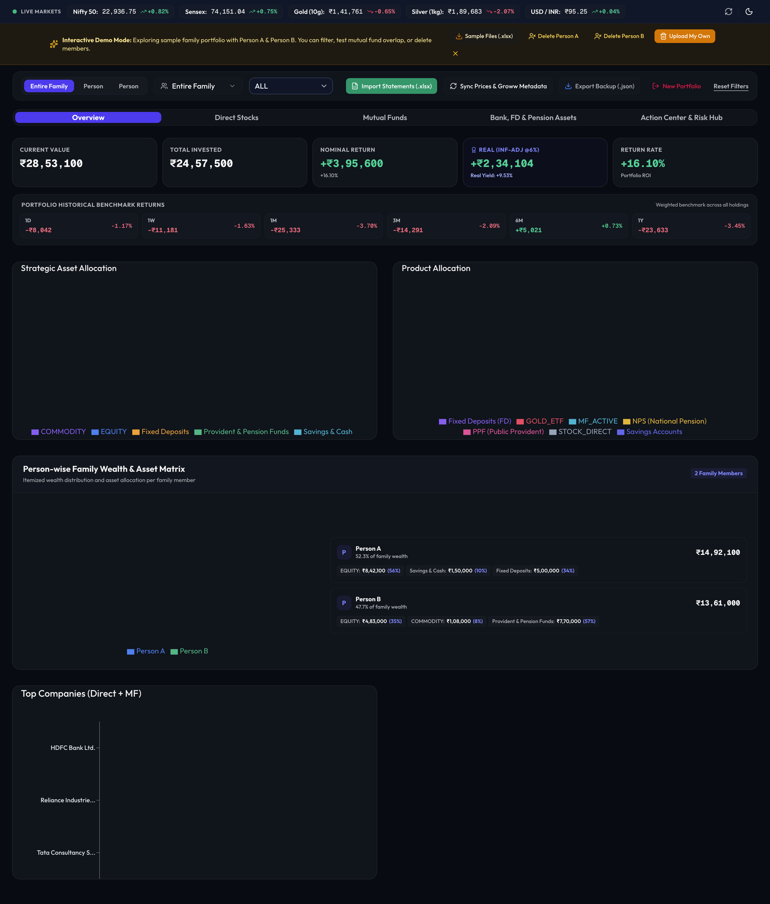

# InvestmentAnalyser 📈

A comprehensive, multi-asset portfolio intelligence and analytics platform designed specifically for Indian investors. Track, analyze, and optimize your entire family's wealth across Mutual Funds, Direct Stocks, Gold/Silver ETFs, Sovereign Gold Bonds (SGBs), Fixed Deposits (FDs), Savings Accounts, PPF, and NPS.



---

## ✨ Key Features

### 1. 👥 Multi-Member Family Aggregation
* Aggregate investments across multiple family members (e.g., *Entire Family*, *Person A*, *Person B*).
* Filter with 1-click pills to drill down into an individual's holdings or view collective household asset allocation.

### 2. 🔍 Mutual Fund Overlap Matrix
* Compute true stock-level overlaps between mutual funds in your portfolio.
* Identify duplicate exposures, AMC concentration, and over-diversification before starting new SIPs.

### 3. 🏦 Bank, FD & Fixed-Income Management
* Consolidate fixed deposits, emergency savings accounts, PPF, EPF, and NPS tier accounts.
* Track interest rates, maturity dates, and annual compounding across institutions (SBI, HDFC, Post Office, etc.).
* Downloadable Excel template (`Bank_and_FD_Template.xlsx`) for bulk importing bank balances.

### 4. 🔒 100% Client-Side & Private
* **Zero Cloud Storage**: All Groww statement parsing happens in-memory or directly in your browser session.
* Your account numbers, PANs, and portfolio balances never touch external databases or third-party servers.
* Automatically persists safely in your browser's `localStorage`.

### 5. 🧪 Interactive Demo Mode (Value Research Style)
* First-time visitors can launch the **Demo Family Portfolio** (Person A & Person B) to explore all charts, overlap matrices, and risk metrics instantly.
* Download 4 ready-to-test Groww Excel statement templates (`.xlsx`) directly from the landing page.
* Seamless auto-replacement: When you upload your real statement, demo data is automatically cleared.

### 6. 💾 1-Click Backup & Restore
* Click **"Export Backup (.json)"** to save your entire portfolio snapshot to your device.
* Re-upload the `.json` file anytime (or on another computer) to restore your dashboard in 1 second.

---

## 🚀 Getting Started

### Prerequisites
* Node.js 18+ or 20+
* npm, pnpm, or yarn

### Installation

1. **Clone the repository**:
   ```bash
   git clone https://github.com/your-username/InvestmentAnalyser.git
   cd InvestmentAnalyser
   ```

2. **Install dependencies**:
   ```bash
   npm install
   ```

3. **Start the local development server**:
   ```bash
   npm run dev
   ```
   Open [http://localhost:3850](http://localhost:3850) in your browser.

---

## 📥 How to Get Your Statements from Groww

1. Open the **Groww app** on your phone.
2. Tap on your **Profile icon** (top-right) $\rightarrow$ **Reports**.
3. Select **Mutual Fund Holdings** (or **Stock Holdings**) $\rightarrow$ Choose **Excel (.xlsx)** $\rightarrow$ Tap **Download / Send to Email**.
4. Drag and drop the downloaded `.xlsx` statement directly onto the dashboard.

---

## 🛠️ Tech Stack

* **Framework**: Next.js (App Router, Turbopack)
* **Language**: TypeScript
* **State Management**: Zustand (with browser `localStorage` persistence)
* **Styling & UI**: Tailwind CSS, Shadcn UI, Lucide Icons, Radix UI
* **Charts & Analytics**: Recharts
* **Spreadsheet Engine**: `xlsx` (SheetJS)
* **Market Data**: Yahoo Finance API integration for live tickers & NAVs

---

## 🛡️ Privacy & Security

This project was built with a strict **privacy-first** design:
* Personal Excel statements in `data/reports/` and personal files like `custom_assets.json` are excluded via `.gitignore`.
* Server endpoints will not serve local disk data in production environments (`NODE_ENV === 'production'`), ensuring zero data leakage when deployed to platforms like Vercel.

---

## 📄 License

MIT License. Feel free to use, modify, and distribute for personal or commercial projects.
